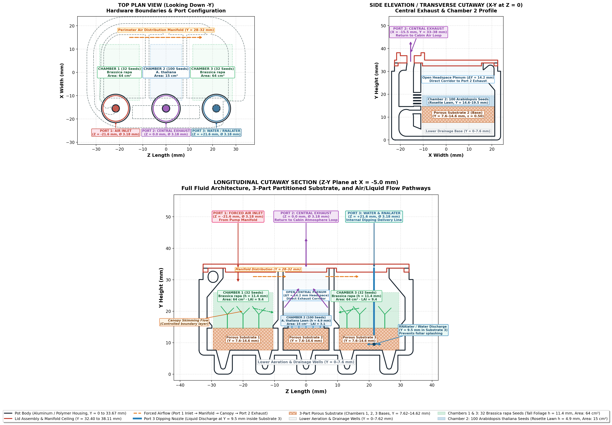
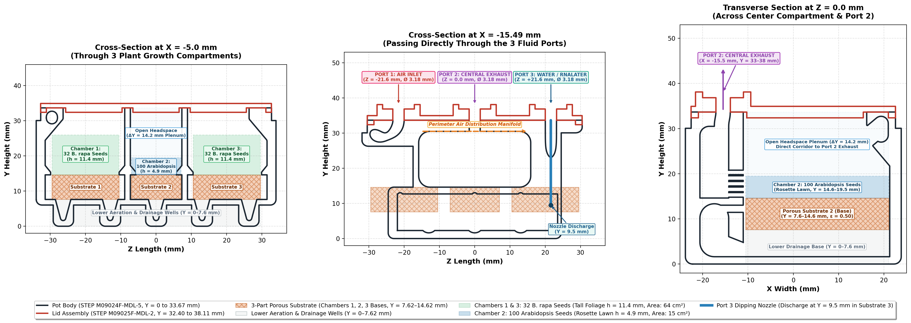

# LEAF GBC2 Lunar Plant Growth Chamber — 3D CFD & Multi-Species Biophysics Model

[](./viewer_3d.html)
[](./index.html)

Computational Fluid Dynamics (CFD), multi-species gas exchange, diurnal photoperiod inversion, and harvest-phase RNAlater fixative perfusion modeling for the **LEAF GBC2 spaceflight plant growth pot (`M09024F-MDL-5.STEP`) and lid (`M09025F-MDL-2.STEP`) assembly** under **Earth ($1.0\,g$, $9.81\ \text{m/s}^2$)** and **Lunar ($0.166\,g$, $1.62\ \text{m/s}^2$)** gravity regimes.

---

## Quick Links

- **Interactive Research Summary Portal**: [`index.html`](./index.html)
- **Interactive 3D Chamber Digital Twin & Live CFD Simulator**: [`viewer_3d.html`](./viewer_3d.html)
- **Orthographic Blueprint (ABAI QC Annotated)**: [`figures/fig_orthographic_projection_annotated.png`](./figures/fig_orthographic_projection_annotated.png) | [`.svg`](./figures/fig_orthographic_projection_annotated.svg)
- **Mated CAD Assembly Cross-Sections**: [`figures/assembly_cross_sections_annotated.png`](./figures/assembly_cross_sections_annotated.png) | [`exact`](./figures/assembly_cross_sections_exact.png)
- **Quantitative Telemetry Tables**: [`results/tables/`](./results/tables/)

---

## 1. Hardware Architecture & CAD Geometry



### 1.1 Mated STEP CAD Envelope
- **Pot Body (`cad/pot.step` / `M09024F-MDL-5`)**: $47.63\ \text{mm}$ (X width) $\times\ 33.67\ \text{mm}$ (Y height) $\times\ 67.95\ \text{mm}$ (Z length).
- **Lid Assembly (`cad/lid.step` / `M09025F-MDL-2`)**: $45.09\ \text{mm}$ (X width) $\times\ 5.71\ \text{mm}$ (Y height) $\times\ 65.41\ \text{mm}$ (Z length), seated on the pot rim at $Y = 33.67\ \text{mm}$ ($Y \in [32.40, 38.11]\ \text{mm}$).
- **Total Internal Fluid Volume**: $64.60\ \text{cm}^3$ (headspace air volume $= 54.05\ \text{cm}^3$; porous media bulk volume $= 10.55\ \text{cm}^3$, void volume $= 5.28\ \text{mL}$ at porosity $\epsilon = 0.50$).
- **Lower Aeration & Drainage Wells ($Y \in [0.00, 7.62]\ \text{mm}$)**: Molded basal channels ($V_{\text{drain}} = 8.74\ \text{cm}^3$) beneath the chamber retainer ledges providing root aeration and capillary buffering.
- **3-Part Partitioned Porous Substrate ($Y \in [7.62, 14.62]\ \text{mm}$)**: Three discrete porous media blocks ($\Delta Y = 7.00\ \text{mm}$, permeability $K = 1.0 \times 10^{-10}\ \text{m}^2$, porosity $\epsilon = 0.50$) seated inside each growth compartment and separated by solid vertical baffles ($Z \in [-9.5, -7.5]\ \text{mm}$ and $Z \in [+7.5, +9.5]\ \text{mm}$).

### 1.2 Fluid Ports ($X = -15.49\ \text{mm}$, $\varnothing 3.18\ \text{mm}$ / $1/8^{\prime\prime}$ ID)
1. **Port 1 ($Z = -21.59\ \text{mm}$) — Forced Air Inlet**: Injects conditioned air from the pump manifold into the upper perimeter distribution channel ($Y = 28\text{--}32\ \text{mm}$).
2. **Port 2 ($Z = 0.00\ \text{mm}$) — Central Air Exhaust**: Positioned directly above central Chamber 2 to collect converging airflow from both lateral chambers and return it to the cabin loop (also serves as the displaced gas vent during harvest fixation).
3. **Port 3 ($Z = +21.59\ \text{mm}$) — Water & RNAlater Delivery Port**: Equipped with an internal vertical dipping nozzle ($L = 24.2\ \text{mm}$) extending down to **$Y = 9.5\ \text{mm}$ inside Substrate Block 3** to ensure bottom-up capillary wetting and eliminate foliar splash damage.



---

## 2. Multi-Species Planting Densities & Canopy Morphometrics

| Parameter | Chamber 1 (*Brassica rapa*) | Chamber 2 (*Arabidopsis thaliana*) | Chamber 3 (*Brassica rapa*) |
| :--- | :--- | :--- | :--- |
| **Axial Span ($Z$)** | $[-30.5, -9.5]\ \text{mm}$ | $[-7.5, +7.5]\ \text{mm}$ (Central) | $[+9.5, +30.5]\ \text{mm}$ |
| **Seed Count & Density** | **32 seeds** ($47.2\ \text{seeds/dm}^2$) | **100 seeds** ($206.2\ \text{seeds/dm}^2$) | **32 seeds** ($47.2\ \text{seeds/dm}^2$) |
| **Single-Plant Leaf Area** | $2.00\ \text{cm}^2$ | $0.15\ \text{cm}^2$ | $2.00\ \text{cm}^2$ |
| **Total Chamber Foliar Area** | **$64.0\ \text{cm}^2$** ($0.0064\ \text{m}^2$) | **$15.0\ \text{cm}^2$** ($0.0015\ \text{m}^2$) | **$64.0\ \text{cm}^2$** ($0.0064\ \text{m}^2$) |
| **Canopy Vertical Span ($Y$)** | $[15.0, 26.0]\ \text{mm}$ ($h = 11.4\ \text{mm}$) | $[15.0, 19.5]\ \text{mm}$ ($h = 4.9\ \text{mm}$) | $[15.0, 26.0]\ \text{mm}$ ($h = 11.4\ \text{mm}$) |
| **Leaf Area Index ($\text{LAI}$)** | $9.44$ | $3.09$ | $9.44$ |
| **Leaf Area Density ($a$)** | $828\ \text{m}^2/\text{m}^3$ | $630\ \text{m}^2/\text{m}^3$ | $828\ \text{m}^2/\text{m}^3$ |
| **Canopy Drag Factor ($D$)** | $8.28\ \text{s}^{-1}$ | $4.72\ \text{s}^{-1}$ | $8.28\ \text{s}^{-1}$ |
| **Characteristic Leaf Length ($L$)** | $20\ \text{mm}$ | $8\ \text{mm}$ | $20\ \text{mm}$ |
| **Substrate Bulk / Void Volume** | $4.02\ \text{cm}^3$ / $2.01\ \text{mL}$ | $2.51\ \text{cm}^3$ / $1.26\ \text{mL}$ | $4.02\ \text{cm}^3$ / $2.01\ \text{mL}$ |
| **Upper Headspace Plenum** | $\Delta Y = 7.7\ \text{mm}$ | **$\Delta Y = 14.2\ \text{mm}$ (Open Plenum)** | $\Delta Y = 7.7\ \text{mm}$ |

---

## 3. Key Simulation Findings & Flight Operational Guidelines

### 3.1 "Dip-and-Converge" Aerodynamic Channelling & Age-of-Air Uniformity
- Forced air entering Port 1 ($Z = -21.6\ \text{mm}$) encounters tall foliage drag ($D = 8.28\ \text{s}^{-1}$) in Chamber 1, skimming across the upper manifold until reaching the step-down above the prostrate *Arabidopsis* rosette carpet in Chamber 2.
- The **$\Delta Y = 14.2\ \text{mm}$ open central plenum** directly beneath Port 2 acts as a low-resistance convergence corridor where lateral streams from Chambers 1 and 3 dip downward, flush the *Arabidopsis* lawn, and exhaust upward through Port 2.
- **Sandberg Conservation Verification**: At nominal flow $Q = 0.50\ \text{L/min}$, the numerical flux-weighted outlet mean age of air is $\theta_{\text{out}} = 7.27\ \text{s}$ vs. theoretical $\tau = V_{\text{fluid}}/Q = 7.75\ \text{s}$ (ratio $= 0.938$). Inter-chamber mean age uniformity is preserved within **$< 1.0\%$** (Ch 1: $6.05\ \text{s}$, Ch 2: $6.10\ \text{s}$, Ch 3: $6.06\ \text{s}$).

### 3.2 Asymmetric Multi-Species Gas Exchange (Earth $1.0\,g$ vs. Lunar $0.166\,g$)

| Regime | Pump Speed ($Q$) | Gravity ($g$) | *B. rapa* (Ch 1 & 3, 32 Seeds) $A_{\text{net}}$ | *B. rapa* $\Delta[CO_2]$ / $\Delta[H_2O]$ | *A. thaliana* (Ch 2, 100 Seeds) $A_{\text{net}}$ | *A. thaliana* $\Delta[CO_2]$ / $\Delta[H_2O]$ |
| :--- | :--- | :--- | :--- | :--- | :--- | :--- |
| **Earth $1.0\,g$ Baseline** | $0.50\ \text{L/min}$ | $9.81\ \text{m/s}^2$ | **$13.04\ \mu\text{mol}\ \text{m}^{-2}\text{s}^{-1}$** | $-3.76\ \text{ppm}$ / $+7.11\ \text{mmol/m}^3$ | **$10.06\ \mu\text{mol}\ \text{m}^{-2}\text{s}^{-1}$** | $-1.31\ \text{ppm}$ / $+2.40\ \text{mmol/m}^3$ |
| **Lunar $0.166\,g$ Uncompensated** | $0.50\ \text{L/min}$ | $1.62\ \text{m/s}^2$ | **$10.63\ \mu\text{mol}\ \text{m}^{-2}\text{s}^{-1}$** ($81.5\%$) | $-3.77\ \text{ppm}$ / $+7.12\ \text{mmol/m}^3$ | **$8.43\ \mu\text{mol}\ \text{m}^{-2}\text{s}^{-1}$** ($83.8\%$) | $-1.32\ \text{ppm}$ / $+2.42\ \text{mmol/m}^3$ |
| **Lunar $0.166\,g$ Compensated** | **$0.85\ \text{L/min}$** | $1.62\ \text{m/s}^2$ | **$10.66\ \mu\text{mol}\ \text{m}^{-2}\text{s}^{-1}$** | **$-2.35\ \text{ppm}$ / $+4.50\ \text{mmol/m}^3$** ($-37\%$) | **$8.44\ \mu\text{mol}\ \text{m}^{-2}\text{s}^{-1}$** | **$-0.85\ \text{ppm}$ / $+1.59\ \text{mmol/m}^3$** ($-37\%$) |

### 3.3 Diurnal Photoperiod Inversion & Lunar Nocturnal Pump Setback
- During the **8h dark skotoperiod**, LED arrays extinguish, leaves radiatively cool ($\Delta T = -0.3\ \text{K}$), and mitochondrial dark respiration emits dense $CO_2$ ($S_{CO2} = +6.0\ \mu\text{mol}\ \text{m}^{-3}\text{s}^{-1}$).
- Under Lunar $0.166\,g$, low-power sleep setbacks ($Q \le 0.10\ \text{L/min}$) allow dense respiratory $CO_2$ to pool in the lower wells ($\Delta[CO_2] > +10\ \text{ppm}$).
- **Flight Rule**: Maintain a **nocturnal lunar pump floor of $Q_{\text{night}} \ge 0.60\ \text{L/min}$** ($\text{Ri} \le 0.05$) to flush respiratory $CO_2$.

### 3.4 Harvest-Phase RNAlater Fixative Perfusion
- **Nominal Injection ($Q_{\text{inj}} = 10\ \text{mL/min}$)**: Root substrate saturation ($5.28\ \text{mL}$ void volume) completes in **$t_{\text{root}} = 31.7\ \text{s}$**; full chamber immersion ($64.60\ \text{mL}$) completes in **$t_{\text{flood}} = 387.6\ \text{s}$ ($6.46\ \text{min}$)** with total pressure drop **$\Delta P = 0.73\ \text{kPa}$**.
- **Rapid Injection ($Q_{\text{inj}} = 20\ \text{mL/min}$)**: Root saturation in **$15.8\ \text{s}$**, full chamber flooding in **$3.23\ \text{min}$**, with **$\Delta P = 1.47\ \text{kPa}$** (well below seal safety margins).

---

## 4. Simulation Figure Suite

| Figure | Description | Files |
| :--- | :--- | :--- |
| **Orthographic Blueprint** | 3-view CAD projection (Top Plan, Side Elevation, Longitudinal Cutaway) with full ABAI QC badges | [PNG](figures/fig_orthographic_projection_annotated.png) · [SVG](figures/fig_orthographic_projection_annotated.svg) |
| **Assembly Cutaways** | Mated STEP cross-sections across compartments ($X=-5\ \text{mm}$), ports ($X=-15.49\ \text{mm}$), and center ($Z=0$) | [Annotated](figures/assembly_cross_sections_annotated.png) · [Exact CAD](figures/assembly_cross_sections_exact.png) |
| **Figure 1** | Parametric pump sweep ($0.05\text{--}4.0\ \text{L/min}$): velocity, boundary-layer conductance, $\Delta[CO_2]$, $A_{\text{net}}$ | [PNG](figures/fig1_pump_speed_vs_aerodynamics.png) · [SVG](figures/fig1_pump_speed_vs_aerodynamics.svg) |
| **Figure 2** | 2D/3D velocity vector fields & scalar distributions comparing Earth $1.0\,g$ vs. Lunar $0.166\,g$ | [PNG](figures/fig2_velocity_fields_earth_vs_lunar.png) · [SVG](figures/fig2_velocity_fields_earth_vs_lunar.svg) |
| **Figure 3** | Lunar compensatory pump sizing curve & regime classification ($\text{Ri}$, $\text{Pe}$, $\text{Gr}/\text{Re}^2$) | [PNG](figures/fig3_lunar_compensatory_pump_curve.png) · [SVG](figures/fig3_lunar_compensatory_pump_curve.svg) |
| **Figure 4** | 3D spatial Mean Age of Air ($\theta$), chamber uniformity, and Sandberg identity verification | [PNG](figures/fig4_mean_age_of_air_and_chamber_uniformity.png) · [SVG](figures/fig4_mean_age_of_air_and_chamber_uniformity.svg) |
| **Figure 5** | Flight hardware benchmark comparing LEAF GBC2 against NASA BRIC, CARA, and Veggie | [PNG](figures/fig5_flight_hardware_benchmark_gbc2_vs_nasa.png) · [SVG](figures/fig5_flight_hardware_benchmark_gbc2_vs_nasa.svg) |
| **Figure 6** | Predicted transcriptomic stress & phytohormone signaling phenotypes (Auxin, ABA, Ethylene) | [PNG](figures/fig6_predicted_hormone_carbon_phenotypes.png) · [SVG](figures/fig6_predicted_hormone_carbon_phenotypes.svg) |
| **Figure 7** | Transient RNAlater perfusion front progression & multi-species asymmetric gas exchange | [PNG](figures/fig7_rnalater_perfusion_and_species_dynamics.png) · [SVG](figures/fig7_rnalater_perfusion_and_species_dynamics.svg) |
| **Figure 8** | Diurnal day/night photoperiod inversion, respiratory $CO_2$ pooling, and nocturnal setback envelope | [PNG](figures/fig8_diurnal_day_night_photoperiod_inversion.png) · [SVG](figures/fig8_diurnal_day_night_photoperiod_inversion.svg) |

---

## 5. Repository Structure & Reproducibility

```text
LEAF_GBC2_pot_model/
├── index.html                           # GitHub Pages Interactive Research Summary Portal
├── viewer_3d.html                       # Interactive 3D WebGL Digital Twin & CFD Simulator
├── README.md                            # Project documentation & summary
├── requirements.txt                     # Python environment dependencies
├── cad/
│   ├── pot.step                         # Native STEP CAD for GBC2 Pot Body (M09024F-MDL-5)
│   └── lid.step                         # Native STEP CAD for GBC2 Lid Assembly (M09025F-MDL-2)
├── geometry/
│   ├── gbc2_assembly.stl                # Mated 3D assembly mesh
│   └── gbc2_grid.npz                    # 3D voxelized domain (60x48x80) with species & substrate tags
├── sim/
│   ├── build_geometry.py                # CAD mating & 3D voxelization pipeline
│   ├── gbc2_cfd_engine.py               # 3D Navier-Stokes, Brinkman-Darcy & FvCB solver
│   ├── advanced_analytics.py            # Mean Age of Air, Sandberg conservation & hormone indices
│   ├── generate_orthographic_projections.py  # 3-view orthographic projection generator
│   ├── generate_assembly_cross_sections.py   # Mated CAD cross-section generator
│   ├── run_parametric_sweep.py          # Parametric pump speed sweep (Figs 1-3)
│   ├── run_advanced_pipeline.py         # Age of air, hardware benchmark & phenotypes (Figs 4-6)
│   ├── simulate_rnalater_perfusion.py   # RNAlater fixation & species asymmetry (Fig 7)
│   └── simulate_diurnal_cycle.py        # Day/night photoperiod inversion (Fig 8)
├── figures/                             # All publication figures (.png and .svg)
└── results/
    └── tables/                          # All quantitative simulation tables (.tsv)
```

### Running the Full Simulation & Visualization Pipeline

```bash
# 1. Create virtual environment and install dependencies
python3 -m venv .venv
.venv/bin/pip install -r requirements.txt

# 2. Rebuild 3D voxel geometry from STEP CAD files
.venv/bin/python sim/build_geometry.py

# 3. Generate Orthographic Projections & CAD Cross-Sections
.venv/bin/python sim/generate_orthographic_projections.py
.venv/bin/python sim/generate_assembly_cross_sections.py

# 4. Run CFD & Biophysics Simulation Suites (Figures 1-8 & TSV tables)
.venv/bin/python sim/run_parametric_sweep.py
.venv/bin/python sim/run_advanced_pipeline.py
.venv/bin/python sim/simulate_rnalater_perfusion.py
.venv/bin/python sim/simulate_diurnal_cycle.py
```
